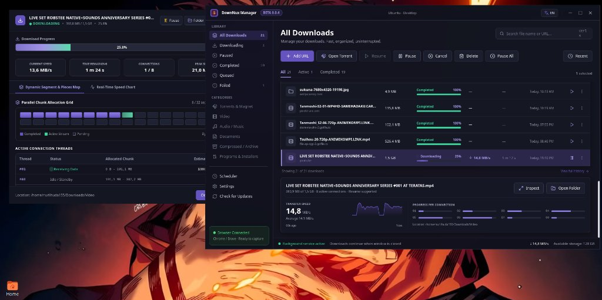
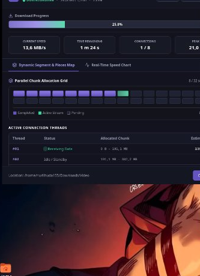
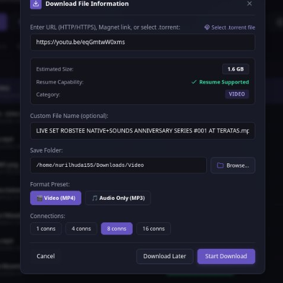

# DownNux Manager

<p align="center">
  
</p>

<p align="center">
  <strong>High-performance, multi-segmented download accelerator and media grabber.</strong><br>
  Built with a decoupled background daemon architecture, dynamic connection chunking, BitTorrent support, and a modern glassmorphism interface.
</p>

<p align="center">
  <a href="https://github.com/Nuril09/DownNux-Manager/releases/latest"></a>
  <a href="LICENSE"></a>
  <a href="#"></a>
  <a href="https://github.com/Nuril09/DownNux-Manager"></a>
</p>

---

## Overview

DownNux Manager brings the battle-tested multi-threaded acceleration workflow of Internet Download Manager (IDM) into a modern, cross-platform ecosystem. Instead of relying on a single HTTP stream, DownNux splits downloads into up to **32 parallel Range connections**, monitors chunk transfers in real time, and persists byte offsets in SQLite WAL storage so interrupted downloads resume instantly without losing data.

Engineered and maintained by **HoodTech**.

---

## Key Highlights

<table>
  <tr>
    <td width="50%" valign="top">
      
      <br>
      <strong>Dynamic Chunk Allocation Visualizer</strong><br>
      A standalone floating progress window inspired by IDM. Displays a 32-segment real-time chunk map, active connection threads, transfer speeds, and remaining time.
    </td>
    <td width="50%" valign="top">
      
      <br>
      <strong>Smart Pre-Download Inspection</strong><br>
      Validates file size, Range resume capability, and content type before starting. Automatically detects video links (YouTube, HLS, DASH) and provides format presets.
    </td>
  </tr>
</table>

### Core Capabilities

* **Multi-Connection Acceleration Engine**: Dynamic file splitting across 1 to 32 parallel connections via a hybrid `aria2` + `yt-dlp` core.
* **Independent Background Daemon**: Active downloads run inside a background system service (`systemd --user` on Linux). Closing the GUI or logging out will **not** cancel active downloads.
* **Standalone Floating Inspector**: Each active download can be monitored in its own compact floating window with real-time transfer sparklines and segment blocks.
* **BitTorrent & Magnet Support**: Built-in support for `.torrent` file imports and Magnet URLs with automatic DHT peer discovery and high-speed public tracker integration.
* **Dedicated Paused Management**: Paused tasks stay accessible under the `Paused` library filter and `Active` subtab for quick one-click resume.
* **Browser Integration Extension**: Native Manifest V3 extensions for Chrome, Brave, Edge, and Firefox. Intercepts file downloads and injects floating video download badges.
* **Crash Resilience**: Embedded SQLite database with Write-Ahead Logging (WAL) ensures atomic progress saves and zero file corruption across system reboots.
* **Bilingual UI**: Toggle between English and Indonesian with instant localization.

---

## Quick Comparison

| Feature | Default Browser | Traditional Tools | DownNux Manager |
| :--- | :---: | :---: | :---: |
| **Multi-Threaded HTTP Chunking** | Single stream | 4 - 8 connections | **Up to 32 parallel connections** |
| **Crash / Reboot Recovery** | Fails / restarts | Basic | **SQLite WAL Atomic Recovery** |
| **Video Sniffer & Muxer** | No | Separate CLI | **Integrated extension + FFmpeg** |
| **Standalone Progress Window** | No | Window only | **Detached floating inspector** |
| **Background Daemon** | Closes with browser | Background tray | **Independent system daemon** |
| **BitTorrent Client** | No | External client | **Native .torrent & Magnet core** |

---

## Installation Guide

### Option 1: Ubuntu / Debian (`.deb` Package) — Recommended

DownNux provides a native `.deb` package that sets up binaries, desktop menu shortcuts, and auto-starts background user services.

```bash
# 1. Download the latest .deb from GitHub Releases
wget https://github.com/Nuril09/DownNux-Manager/releases/download/v0.0.4/downnux-manager_0.0.4_amd64.deb

# 2. Install using apt (resolves system dependencies automatically)
sudo apt install ./downnux-manager_0.0.4_amd64.deb
```

Once installed, open **DownNux Manager** from your desktop application launcher or run `downnux-gui` in terminal.

---

### Option 2: Linux Portable (`.tar.gz`)

For environments where you prefer not to install system packages:

```bash
# Extract the archive
tar -xzf downnux-manager_0.0.4_linux_x64.tar.gz
cd downnux-manager_0.0.4_linux_x64

# Start the application
bash start-downnux.sh
```

---

### Option 3: Developer Setup (Build from Source)

```bash
# Clone the repository
git clone https://github.com/Nuril09/DownNux-Manager.git
cd DownNux-Manager

# Install dependencies and build bundles
pnpm install
bash scripts/install-dev.sh
```

---

### Multiplatform Status (Windows & macOS)

* **Windows (`.exe` NSIS Installer)**: Configuration is set up under `src-tauri` and automated via GitHub Actions CI/CD to build standalone `.exe` installers.
* **macOS (`.dmg` Disk Image)**: Configured for Universal Apple Silicon / Intel builds via GitHub Actions.
* Portable fallback scripts (`start-downnux.bat` and `start-downnux.command`) are available in the [Releases section](https://github.com/Nuril09/DownNux-Manager/releases).

---

## Browser Integration Setup

The browser extension allows DownNux to intercept file downloads automatically and adds a floating download badge on video players (YouTube, Vimeo, Twitter/X, TikTok).

### Chromium Browsers (Google Chrome, Brave, Microsoft Edge, Opera)

1. Open `chrome://extensions` or `brave://extensions`.
2. Enable **Developer mode** (top-right toggle).
3. Click **Load unpacked** and select the folder:
   ```
   DownNux-Manager/apps/extension
   ```
4. The extension icon will appear in your toolbar and the DownNux sidebar will show `Browser Connected`.

### Mozilla Firefox

1. Open `about:debugging#/runtime/this-firefox`.
2. Click **Load Temporary Add-on...**
3. Select the file:
   ```
   DownNux-Manager/apps/extension/manifest.firefox.json
   ```

---

## How to Use

### 1. Adding a Download
* **Via GUI**: Click **+ Add URL** in the top toolbar. Paste any direct HTTP/HTTPS link, video URL, or Magnet link.
* **Via Torrent File**: Click **Select .torrent file** in the dialog or drag & drop `.torrent` files directly.
* **Via Browser**: Click any download link in your browser; the extension relays it directly to DownNux with session cookies and referrers intact.

### 2. Monitoring Progress
* When a download starts, the **Floating Inspector** opens automatically showing 32 chunk allocations and real-time speed.
* To reopen the inspector at any time, click the **Inspect** button or the **Play** button on any active row.

### 3. Managing Downloads
* **3-Dots Action Menu**: Click the three dots (`⋮`) on any row to:
  * **Open File**: Launch the completed file directly with your default desktop app.
  * **Open Folder**: Open the destination directory in your file manager.
  * **Repair Download**: Re-verify checksums and re-download broken or corrupted segments.
  * **Delete**: Remove the task from the list and delete the downloaded file from disk.
* **Paused Library**: View all paused tasks under the `Paused` sidebar tab and resume them in batch.

### 4. Command Line Interface (CLI)

You can manage all downloads headlessly using the `downnux` CLI:

```bash
# Check daemon status
downnux ping

# List active downloads
downnux ls

# Start a download with 16 connections
downnux add "https://example.com/largefile.iso" -c 16

# Pause or resume a task
downnux pause <task-id>
downnux resume <task-id>
```

---

## Architecture

```
┌────────────────────────────────────────────────────────┐
│                   Web Browsers                         │
│  Chrome  ·  Brave  ·  Edge  ·  Chromium  ·  Firefox    │
│  (Manifest V3 Extension + Floating Video Sniffer)      │
└──────────────────────────┬─────────────────────────────┘
                           │ Native Messaging (stdio)
┌──────────────────────────▼─────────────────────────────┐
│                 apps/native-host                       │
│    Native Messaging Bridge (Validates & Forwards)      │
└──────────────────────────┬─────────────────────────────┘
                           │ Unix Domain Socket
┌──────────────────────────▼─────────────────────────────┐
│                   apps/daemon                          │
│   Background Service (systemd --user, SQLite WAL)      │
│   Hybrid Engine: aria2c (Files/Torrents) + yt-dlp      │
│   HTTP / WebSocket Local RPC Server (Port 44990)       │
└──────────────┬──────────────────────────┬──────────────┘
               │                          │
┌──────────────▼────────────┐  ┌──────────▼──────────────┐
               │                          │
        apps/gui                   CLI (downnux)
 Native Desktop Window / UI     Terminal Control Client
```

---

## Service Management

DownNux runs as a user-level systemd service:

```bash
# Check daemon status
systemctl --user status downnux-daemon

# View live daemon logs
journalctl --user -u downnux-daemon -f

# Restart daemon
systemctl --user restart downnux-daemon
```

---

## Credits & License

DownNux Manager is engineered with ❤️ by the **HoodTech** team.

* **Project Lead**: HoodTech (<https://github.com/Nuril09/DownNux-Manager>)
* **Underlying Engines**: `aria2`, `yt-dlp`, `FFmpeg`, `Tauri`
* **License**: Released under the **GNU General Public License v3.0 (GPLv3)**. See [LICENSE](LICENSE) for details.

Copyright (C) 2026 **HoodTech**.
