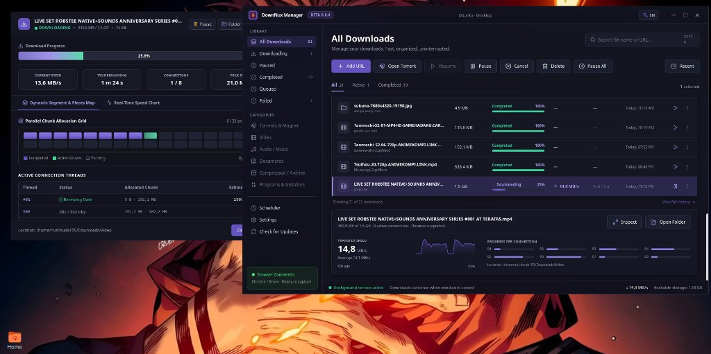
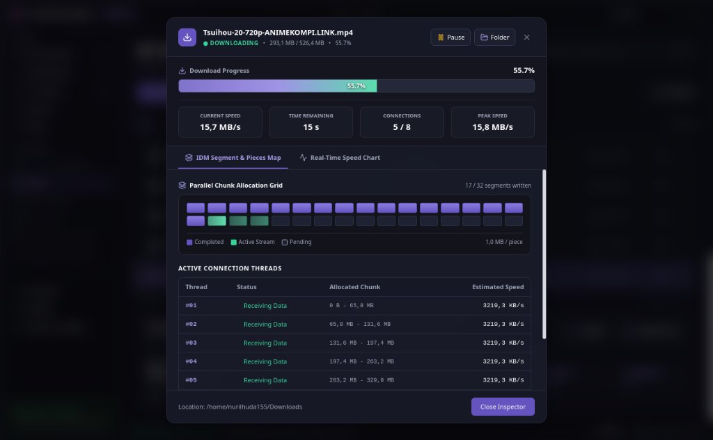
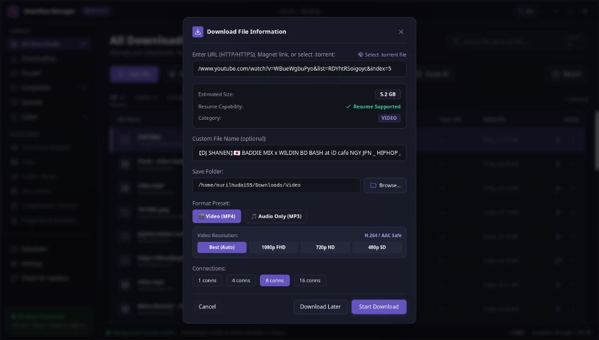

# DownNux Manager

<p align="center">
  
</p>

<p align="center">
  <strong>High-performance, multi-segmented download accelerator and media grabber.</strong><br>
  Built with a decoupled background daemon architecture, dynamic connection chunking, BitTorrent support, and a modern glassmorphism interface.
</p>

<p align="center">
  <a href="https://github.com/Nuril09/DownNux-Manager/releases/latest"></a>
  <a href="https://downnux-manager.vercel.app"></a>
  <a href="LICENSE"></a>
  <a href="#"></a>
  <a href="https://hoodtech.my.id/"></a>
</p>

---

## What's New in v0.0.6

> **Major Milestone**: DownNux Manager is now a **100% self-contained standalone application** across Windows, macOS, and Linux with zero external dependency setup.

* **Windows & macOS Zero-Setup Installer**:
  * Bundled standalone background engine (`engine/daemon.mjs`), embedded Node.js 22 runtime, `aria2c`, `yt-dlp`, and `FFmpeg` directly inside the installer packages.
  * No need to install Node, Python, or terminal tools manually. Double-click the installer and start downloading immediately.
* **Silent Engine Auto-Launcher**:
  * The Tauri desktop application now automatically detects whether the background daemon is alive on `127.0.0.1:44990`.
  * If inactive, it spawns the bundled engine in the background with `CREATE_NO_WINDOW` on Windows (no console/cmd window popup).
* **Native OS Shell Integrations**:
  * **Windows**: Implemented native file selection via `explorer.exe /select,"<file>"` and native folder browsing via PowerShell `FolderBrowserDialog`.
  * **macOS**: Implemented native Finder file reveal (`open -R`) and AppleScript folder chooser.
  * **Linux**: Dual support for `nautilus --select` and standard `xdg-open`.
* **Resilient IPC & Storage**:
  * Localhost HTTP & WebSocket server with automatic port contention fallback and reconnection logic.
  * Native storage directories: `%APPDATA%\downnux` on Windows, `~/Library/Application Support/downnux` on macOS, and XDG Base Directory on Linux.

---

## Overview

DownNux Manager brings the battle-tested multi-threaded acceleration workflow of Internet Download Manager (IDM) into a modern, cross-platform ecosystem. Instead of relying on a single HTTP stream, DownNux splits downloads into up to **32 parallel Range connections**, monitors chunk transfers in real time, and persists byte offsets in SQLite WAL storage so interrupted downloads resume instantly without losing data.

Official Website: [**downnux-manager.vercel.app**](https://downnux-manager.vercel.app/)  
Engineered and maintained by [**HoodTech**](https://hoodtech.my.id/).

---

## Key Highlights

<table>
  <tr>
    <td width="50%" valign="top">
      
      <br>
      <strong>Dynamic Chunk Allocation Visualizer</strong><br>
      A standalone floating progress window inspired by IDM. Displays a 32-segment real-time chunk map, active connection threads, transfer speeds, and remaining time.
    </td>
    <td width="50%" valign="top">
      
      <br>
      <strong>Smart Pre-Download Inspection</strong><br>
      Validates file size, Range resume capability, and content type before starting. Automatically detects video links (YouTube, HLS, DASH) and provides format presets.
    </td>
  </tr>
</table>

### Core Capabilities

* **Multi-Connection Acceleration Engine**: Dynamic file splitting across 1 to 32 parallel connections via a hybrid `aria2` + `yt-dlp` core.
* **Independent Background Daemon**: Active downloads run inside a background system service. Closing the GUI window will **not** cancel active downloads.
* **Standalone Floating Inspector**: Each active download can be monitored in its own compact floating window with real-time transfer sparklines and segment blocks.
* **BitTorrent & Magnet Support**: Built-in support for `.torrent` file imports and Magnet URLs with automatic DHT peer discovery and high-speed public tracker integration.
* **Dedicated Paused Management**: Paused tasks stay accessible under the `Paused` library filter and `Active` subtab for quick one-click resume.
* **Browser Integration Extension**: Native Manifest V3 extensions for Chrome, Brave, Edge, and Firefox. Intercepts file downloads and injects floating video download badges.
* **Crash Resilience**: Embedded SQLite database with Write-Ahead Logging (WAL) ensures atomic progress saves and zero file corruption across system reboots.
* **Bilingual UI**: Toggle between English and Indonesian with instant localization.

---

## Quick Comparison

| Feature | Default Browser | Traditional Tools | DownNux Manager |
| :--- | :---: | :---: | :---: |
| **Multi-Threaded HTTP Chunking** | Single stream | 4 - 8 connections | **Up to 32 parallel connections** |
| **Crash / Reboot Recovery** | Fails / restarts | Basic | **SQLite WAL Atomic Recovery** |
| **Video Sniffer & Muxer** | No | Separate CLI | **Integrated extension + FFmpeg** |
| **Standalone Progress Window** | No | Window only | **Detached floating inspector** |
| **Background Daemon** | Closes with browser | Background tray | **Independent system daemon** |
| **BitTorrent Client** | No | External client | **Native .torrent & Magnet core** |
| **Zero-Setup Multiplatform** | N/A | Manual dependencies | **Embedded binaries in installer** |

---

## Installation Guide

### Windows (10 / 11 64-bit) — Standalone Installer

Download the official NSIS installer. All dependencies (`node.exe`, `aria2c.exe`, `yt-dlp.exe`, `ffmpeg.exe`, and `daemon.mjs`) are bundled automatically:

1. Download [**DownNux.Manager_0.0.6_x64-setup.exe**](https://github.com/Nuril09/DownNux-Manager/releases/download/v0.0.6/DownNux.Manager_0.0.6_x64-setup.exe).
2. Double-click the installer and complete the setup.
3. Launch DownNux Manager from the Start Menu or desktop shortcut.

---

### macOS (Apple Silicon & Intel) — Disk Image

1. Download [**DownNux.Manager_0.0.6_aarch64.dmg**](https://github.com/Nuril09/DownNux-Manager/releases/download/v0.0.6/DownNux.Manager_0.0.6_aarch64.dmg) (Apple Silicon) or Universal portable zip.
2. Open the `.dmg` file and drag **DownNux Manager** into your `/Applications` folder.
3. Open DownNux Manager from Launchpad or Spotlight.

---

### Linux (Ubuntu, Debian, Fedora, Arch, openSUSE)

#### Option A: Debian / Ubuntu (`.deb` Package)

```bash
# 1. Download the latest .deb package
wget https://github.com/Nuril09/DownNux-Manager/releases/download/v0.0.6/DownNux.Manager_0.0.6_amd64.deb

# 2. Install using apt (resolves system dependencies automatically)
sudo apt install ./DownNux.Manager_0.0.6_amd64.deb
```

#### Option B: Standalone Linux AppImage

```bash
chmod +x DownNux.Manager_0.0.6_amd64.AppImage
./DownNux.Manager_0.0.6_amd64.AppImage
```

---

## Browser Integration Setup

The browser extension allows DownNux to intercept file downloads automatically and adds a floating download badge on video players (YouTube, Vimeo, Twitter/X, TikTok).

### Chromium Browsers (Google Chrome, Brave, Microsoft Edge, Opera)

1. Open `chrome://extensions` or `brave://extensions`.
2. Enable **Developer mode** (top-right toggle).
3. Click **Load unpacked** and select the folder:
   ```
   DownNux-Manager/apps/extension
   ```
4. The extension icon will appear in your toolbar and the DownNux sidebar will show `Browser Connected`.

### Mozilla Firefox

1. Open `about:debugging#/runtime/this-firefox`.
2. Click **Load Temporary Add-on...**
3. Select the file:
   ```
   DownNux-Manager/apps/extension/manifest.firefox.json
   ```

---

## How to Use

### 1. Adding a Download
* **Via GUI**: Click **+ Add URL** in the top toolbar. Paste any direct HTTP/HTTPS link, video URL, or Magnet link.
* **Via Torrent File**: Click **Select .torrent file** in the dialog or drag & drop `.torrent` files directly.
* **Via Browser**: Click any download link in your browser; the extension relays it directly to DownNux with session cookies and referrers intact.

### 2. Monitoring Progress
* When a download starts, the **Floating Inspector** opens automatically showing 32 chunk allocations and real-time speed.
* To reopen the inspector at any time, click the **Inspect** button or the **Play** button on any active row.

### 3. Managing Downloads
* **3-Dots Action Menu**: Click the three dots (`⋮`) on any row to:
  * **Open File**: Launch the completed file directly with your default desktop app.
  * **Open Folder**: Open the destination directory in your file manager.
  * **Repair Download**: Re-verify checksums and re-download broken or corrupted segments.
  * **Delete**: Remove the task from the list and delete the downloaded file from disk.
* **Paused Library**: View all paused tasks under the `Paused` sidebar tab and resume them in batch.

### 4. Command Line Interface (CLI)

You can manage all downloads headlessly using the `downnux` CLI:

```bash
# Check daemon status
downnux ping

# List active downloads
downnux ls

# Start a download with 16 connections
downnux add "https://example.com/largefile.iso" -c 16

# Pause or resume a task
downnux pause <task-id>
downnux resume <task-id>
```

---

## Architecture

```
┌────────────────────────────────────────────────────────┐
│                   Web Browsers                         │
│  Chrome  ·  Brave  ·  Edge  ·  Chromium  ·  Firefox    │
│  (Manifest V3 Extension + Floating Video Sniffer)      │
└──────────────────────────┬─────────────────────────────┘
                           │ Native Messaging (stdio)
┌──────────────────────────▼─────────────────────────────┐
│                 apps/native-host                       │
│    Native Messaging Bridge (Validates & Forwards)      │
└──────────────────────────┬─────────────────────────────┘
                           │ Localhost HTTP/WebSocket (Port 44990)
┌──────────────────────────▼─────────────────────────────┐
│                   apps/daemon                          │
│   Background Service (Auto-Launched by Tauri / systemd)│
│   Hybrid Engine: aria2c (Files/Torrents) + yt-dlp      │
│   SQLite Write-Ahead Logging (WAL) State Database      │
└──────────────┬──────────────────────────┬──────────────┘
               │                          │
┌──────────────▼────────────┐  ┌──────────▼──────────────┐
│        apps/gui           │  │      CLI (downnux)      │
│ Native Desktop Window / UI│  │ Terminal Control Client │
└───────────────────────────┘  └─────────────────────────┘
```

---

## Credits & License

DownNux Manager is engineered with ❤️ by the [**HoodTech**](https://hoodtech.my.id/) team.

* **Project Lead & Organization**: [HoodTech](https://hoodtech.my.id/) (<https://hoodtech.my.id/>)
* **Underlying Engines**: `aria2`, `yt-dlp`, `FFmpeg`, `Tauri`
* **License**: Released under the **GNU General Public License v3.0 (GPLv3)**. See [LICENSE](LICENSE) for details.

Copyright (C) 2026 [**HoodTech**](https://hoodtech.my.id/).
